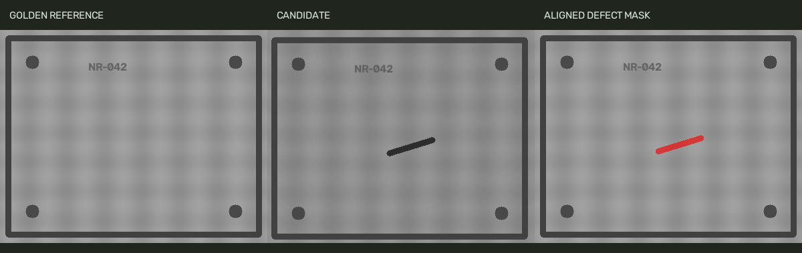

# Golden Reference Surface Defect Inspection

An independent quality-inspection demonstrator for one textured, planar part viewed under a fixed camera.



## What it does

Translation-only ECC registration aligns each candidate to a golden reference. A robust linear brightness fit reduces global lighting differences. Absolute residuals are thresholded, cleaned with morphological operations and grouped into connected defect regions. Low registration confidence causes an explicit review/error result instead of silently passing an image. Defect masks are represented in the aligned reference coordinate system.

## Quick start

Tested with Python 3.12 on Linux. These commands run without a camera or graphical display.

```bash
python -m venv .venv
# Windows PowerShell: .venv\Scripts\Activate.ps1
source .venv/bin/activate  # Linux / WSL
python -m pip install -r requirements-dev.txt
python -m pytest -q
python app.py --demo
```

On Windows, replace the `source` line with the PowerShell activation command shown in the comment. On systems where the executable is named `python3`, use it for the first command. The demo writes `outputs/results.json` and visual outputs. No private images or industrial datasets are required.

## Verified result

4 tests passed. On 40 generated images (20 defective, 20 clean), the fixed pipeline produced 20 true positives, 20 true negatives, no false positives, no false negatives and no registration failures. Mean defect-pixel IoU was 0.919. This is a synthetic benchmark with simple scratches/spots, translations up to 3 pixels, global brightness changes and noise.

## Inspect your own image

```bash
python app.py --reference good-part.png --image candidate.png --threshold 22 --output inspection
```

Inputs must have the same dimensions and show the same part in a fixed fixture. The output includes a defect mask, a three-panel comparison and JSON with registration and region information. A 25-pixel border is excluded from inspection.

## Files

- `app.py`: CLI, input handling, synthetic demo and output generation.
- Core module: reusable algorithm and validation logic.
- `tests/`: regression checks including failure conditions.
- `outputs/`: generated evidence from the included experiment.
- `REPORT.md`: project rationale, method, evaluation and limitations.

## Limits and next step

The alignment model only covers translation, not rotation, perspective or deformation. A golden image must represent normal part variation. Reflective texture, shadows, drift and unseen defects can increase false alarms. The synthetic benchmark has no real production images and no learned defect model; its perfect image-level classification is not a factory performance estimate.

Collect normal and defective samples from one real part family; define separate development and held-out test sets. Measure precision, recall, per-defect sensitivity and the review rate. Add pose registration and compare an anomaly-detection method when enough images are available.

## References

- https://docs.opencv.org/4.x/dc/d6b/group__video__track.html
- https://docs.opencv.org/4.x/d9/d61/tutorial_py_morphological_ops.html
